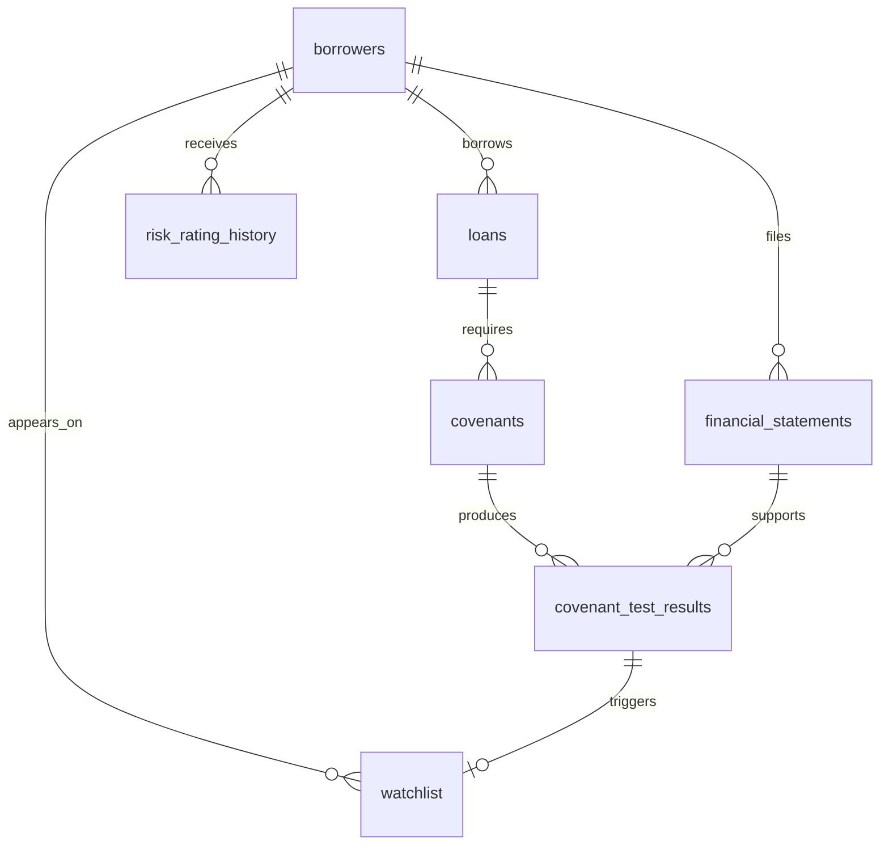

# Core entity relationships

`rating_audit` retains identifiers without foreign keys so deleted rating records can still be audited. `portfolio_snapshots` stores monthly aggregates. SEC staging tables retain raw strings and source-quarter provenance, separate from typed application records.

Ratings use a proposed 1–10 scale; the team must agree on its meaning before generation. Ratios and statements retain duration and accession information to avoid silently mixing annual, quarterly, and amended observations. Covenant tests must validate that the statement borrower matches the loan borrower; this cross-table rule belongs in the upcoming testing function.
