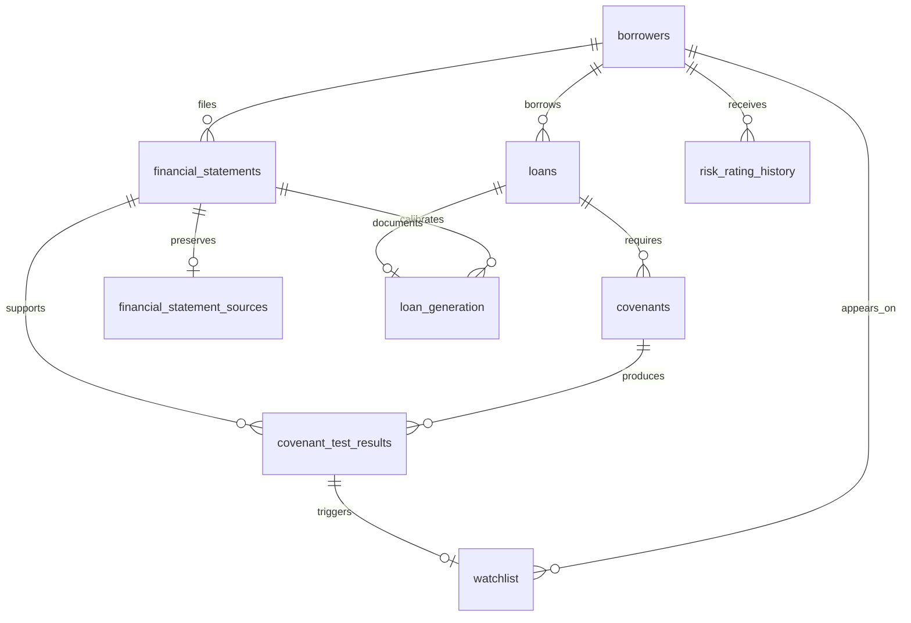

# Core entity relationships

`financial_statement_sources` keeps the original CSV rows and filing dates. Income values in `financial_statements` are normalized to standalone quarters. `loan_generation` records the baseline statement and seed used for each loan.

`rating_audit` keeps old/new ratings even after a rating record is deleted, so its identifiers have no foreign keys. `portfolio_snapshots` stores monthly totals. Raw SEC staging tables are separate from the pilot tables.

The monitoring functions check borrower identity, filing availability, loan dates, and quarter duration. Report views and stored summaries use the `reporting` schema. See [risk rules](risk_policy.md) and [monitoring](monitoring.md) for details.
