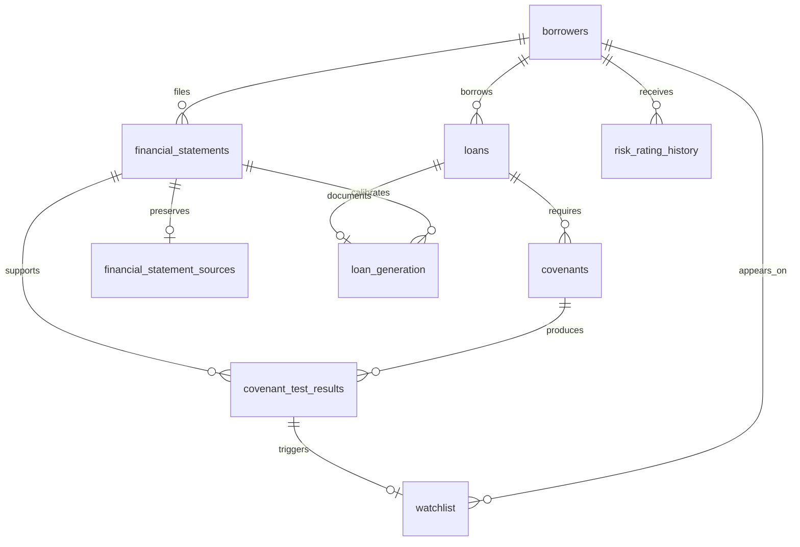

# Core entity relationships

`rating_audit` retains identifiers without foreign keys so deleted rating records can still be audited. `portfolio_snapshots` stores monthly aggregates. SEC staging tables retain raw strings and source-quarter provenance, separate from typed application records.

Ratings use the documented synthetic 1–10 scale in `risk_policy.md`, with 1 lowest and 10 highest monitored risk. `financial_statement_sources` retains the original 48-column CSV row and filing date; normalized application income values have 3-month duration, including FY-derived Q4. `loan_generation` links the loan to the exact baseline statement and seed/manifest. The implemented Week 3 testing function validates cross-table borrower identity, availability, active dates and quarter duration; guard triggers also reject forged results. Rating assessments link to their source statement, while audit identifiers intentionally lack foreign keys so deletion retains evidence. Report views and CTAS tables live in the separate `reporting` schema.
